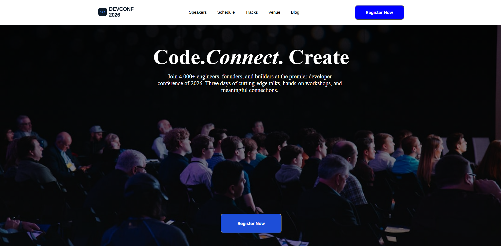
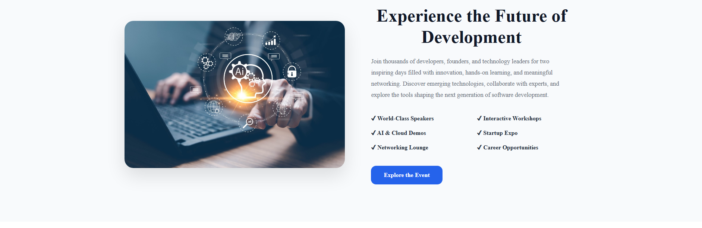

# 🚀 DevConf 2026

A responsive conference website built for **DevConf 2026**, featuring a modern event landing page with speakers, schedules, tracks, venue information, pricing plans, and registration sections.

## 🌐 Live Website

[**View Live Website**](https://b14-a01-devconf-portfolio.vercel.app/)

## 💻 GitHub Repository

[**View Source Code**](https://github.com/Raihanz697/B14-A01-DevConf-portfolio)

## ✨ Features

- 📱 Fully responsive design
- 🎤 Speakers section
- 📅 Event schedule
- 🛤️ Conference tracks
- 📍 Venue information
- 📝 Blog section
- 💳 Pricing plans
- 🎟️ Registration call-to-action
- 🎨 Modern conference-themed UI
- 📱 Mobile-friendly layout

## 🛠️ Tech Stack

## 📸 Preview
Devconf:

Future Development: 

## 📂 Project Structure

## 📁 Project Structure

B14-A01-DevConf-portfolio/
│
├── assets/
│   ├── andrej.png
│   ├── banner.jpg
│   ├── demis.png
│   ├── devconf-preview.png
│   ├── footer-logo.png
│   ├── Future-development-preview.png
│   ├── future-web-dev.jpg
│   ├── gary.png
│   ├── logo-mini.png
│   ├── logo.png
│   └── mustafa.png
│
├── styles/
│   └── styles.css
│
├── index.html
├── PROMPTS.md
└── README.md

## 🎯 Project Purpose

This project was created as a frontend practice project to strengthen my understanding of **HTML structure, CSS styling, responsive layouts, Flexbox, Grid, and modern web design principles**.

